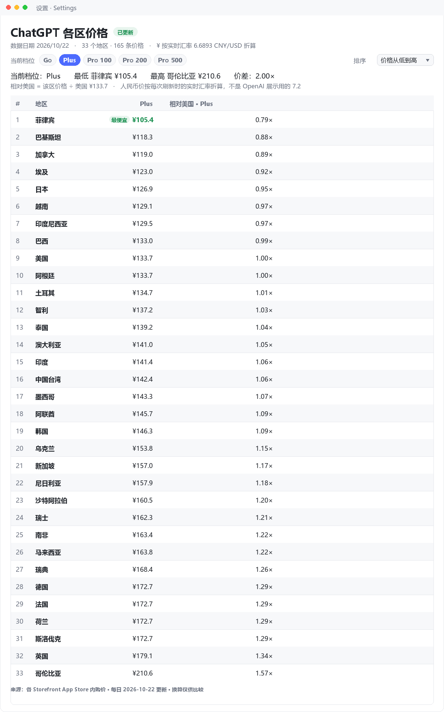

# dsh-chatgpt-price

[](LICENSE)

> ChatGPT 各国订阅价格看板 — a [DeepSeek Harness](https://github.com/deepseek-ai) plugin that
> keeps a **daily-refreshed** table of what ChatGPT costs in each country's App Store
> (Go / Plus / Pro 100 / Pro 200 / Pro 500), converted to CNY at the **live USD/CNY rate
> fetched on every refresh**, with a day-over-day change mark, plan selection and per-plan sorting.



## What it does

| | |
| --- | --- |
| **Source** | `apps.apple.com/{storefront}/app/chatgpt/id6448311069` — public, fast, tax-inclusive in-app prices |
| **Plans** | Go · Plus · Pro 100 · Pro 200 · Pro 500 (consumables such as `N Credits` are dropped) |
| **Regions** | 33 storefronts by default, including PH / PK / VN / ID / EG / AR / CO / CL / NG / UA; HK / CN report "not sold there" instead of a fake price |
| **Conversion** | local → USD (per-currency rate) → CNY at the **live USD/CNY rate of that same refresh** |
| **Refresh** | once a day at `refreshHour` in `timeZone`, plus a boot refresh when the cache is older than 20 h |
| **UI** | a Settings page, plus an optional `dsh-better-sidebar` tab |
| **Agent tools** | `chatgpt_price_board`, `refresh_chatgpt_prices` |

### 界面用法

- 顶部档位按钮（Go / Plus / Pro 100 / Pro 200 / Pro 500）就是「当前档位」选择器：
  摘要行的最低/最高/价差、**相对美国**列以及所有排序都按选中档位计算；再点一次已选
  档位即回到「全部档位」，列出所有列。
- 「排序」下拉：默认顺序 / 价格从低到高 / 价格从高到低 / 相对美国从低到高。没取到
  价格的地区始终排在最后，选择会被记住。
- 当前档位里最便宜的一格标「最便宜」，行首 `#` 是当前排序下的名次。

## Why the App Store and not chatgpt.com

`chatgpt.com/pricing` renders its price numbers client-side: the server HTML contains
plan cards with an empty price span, and the page is byte-identical for every
`?country=`. `/backend-api/payments/checkout/prices` answers 404. The App Store product
page, in contrast, is public, fast and embeds every in-app purchase as a
`leadingText` / `trailingText` pair ("ChatGPT Plus" → "¥3,000"). Two caveats the parser
handles:

- consumable rows (`100 Credits` …) are not plans and are dropped;
- the list contains a **duplicate** `ChatGPT Plus` row carrying the Pro-200 price, so
  duplicates are resolved to the **lowest** amount.

Hong Kong and mainland China storefronts return 404 (the app is not sold there); those
regions are reported as unavailable instead of being silently missing.

## Install

The bundle is a normal file package; install the directory, not a tarball:

```powershell
git clone https://github.com/chaolee111/dsh-chatgpt-price.git
dsh plugin --profile desktop add ./dsh-chatgpt-price
```

or from the Harness UI: **Settings → Plugins → install bundle**, choosing this folder.
The bundle patch inserts one host row (`id: chatgpt-price`). Restart the app to mount it.

## Config

Override the row in the profile's `cordis.patch.yml` (a patch replaces the whole
`config`, so restate every key you keep):

```yaml
- id: chatgpt-price
  config:
    regions: [US, JP, TW, SG, IN, GB, DE, BR, TR, AU]
    refreshHour: 9
    timeZone: Asia/Shanghai
```

| key | default | meaning |
| --- | --- | --- |
| `regions` | 33 storefronts | App Store storefront codes to track |
| `timeZone` / `refreshHour` | `Asia/Shanghai` / `9` | when the daily refresh happens |
| `rateSources` | open.er-api → exchangerate-api → frankfurter | FX providers, tried in order on **every** refresh |
| `requestTimeoutMs` | `20000` | per-request timeout |
| `concurrency` / `requestsPerSecond` | `4` / `6` | politeness limits |
| `retries` | `2` | per-region retries after a failed page (404 is never retried) |
| `retryDelayMs` | `800` | retry backoff base; attempt N waits N × this |
| `retryMinutes` | `5` | re-run the whole refresh this long after a failed/partial run (`0` disables) |
| `autoRefreshOnBoot` | `true` | refresh at startup when the snapshot is older than 20 h |
| `maxHistoryDays` | `90` | days of history kept in the snapshot |

## Architecture

```
lib/index.js    host half: schedule tick, routes, agent tools, config schema
lib/board.js    snapshot store: scrape → convert → persist (tmp + rename) → history
lib/scrape.js   App Store page → { plan, amount, currency } pairs
lib/money.js    price parsing (comma/space decimals, ISO codes) + FX conversion
lib/shared.js   route names, plan ids, record shapes
lib/client.js   browser half: Settings page + optional sidebar tab
locale/         display strings for plugin search (zh / en)
```

- **Host half** does one scrape per day for every tracked region, refetches the live FX
  table on the same run, writes an atomic JSON file, and exposes two routes and two agent
  tools. Every open window reads the cache, so ten windows cost zero extra requests.
- **Browser half** only *reads* the cached snapshot from the host and renders it with
  theme tokens (`--dsw-alias-*`), so light and dark follow the shell.

## Routes and tools

| kind | name | purpose |
| --- | --- | --- |
| `GET` | `/plugins/dsh-chatgpt-price/snapshot` | the cached snapshot (loopback only) |
| `POST` | `/plugins/dsh-chatgpt-price/refresh` | force a refresh, returns the new snapshot (loopback only) |
| tool | `chatgpt_price_board` | read rows, filter by region / plan |
| tool | `refresh_chatgpt_prices` | force a refresh and summarise the result |

The snapshot file is `chatgpt-price.json` in the DSH data directory.

## Notes on the numbers

App Store in-app purchase list prices include local tax outside the US, while the web
checkout may show a different figure for the same plan — the checkout page wins.

The ¥ column is a **real-cost estimate**, not a sticker conversion. Every refresh
refetches the USD rate table and multiplies by the live USD/CNY rate, so the number
tracks the market. Two things it cannot know:

- **OpenAI's displayed 1 USD = 7.2 CNY is not a settlement rate.** It is the figure
  OpenAI shows on its pricing pages; your card issuer still converts at the live rate.
- **Card-side fees** (a 1%–1.5% foreign-transaction fee on many Chinese cards) are not
  included, so the true bill can be a few percent above this column.

If every rate provider fails, the CNY column is left empty for that refresh rather than
falling back to a fixed 7.2 — a made-up rate would look authoritative and be wrong.

## Failure handling

The storefront requests leave through a proxy, and a proxy can answer one request with
the wrong page (a bland shell with no product markup) while the next request for the
same URL is fine. The board therefore never treats one bad answer as a fact:

- **Per-region retry** — a failed page is retried up to `retries` times with linear
  backoff. A `404` is a verdict ("not sold in this storefront") and is *not* retried.
- **Carry-forward** — a region that still fails keeps its previous amounts, each marked
  `stale: true`, so one bad page cannot blank a column.
- **Whole-run retry** — a run that reads nothing, or only some regions, becomes due again
  after `retryMinutes` instead of waiting for tomorrow's slot. The scheduler wakes every
  minute to check, and the snapshot message says how many regions recovered on retry.
- **Atomic write** — the snapshot is written to a temp file and renamed, so a crash
  mid-write cannot leave truncated JSON behind.

The screenshot is regenerated from a real snapshot, with no hand-edited numbers:

```powershell
python docs/make_screenshot.py "$env:USERPROFILE\.dsh\chatgpt-price.json" docs/screenshot.png
```

The script needs only Pillow. It re-applies the table's own ordering rules (plan
selection, cheapest-first sort, vs-US ratio), so the picture matches what the plugin
renders for the same data.

## License

[MIT](LICENSE)
